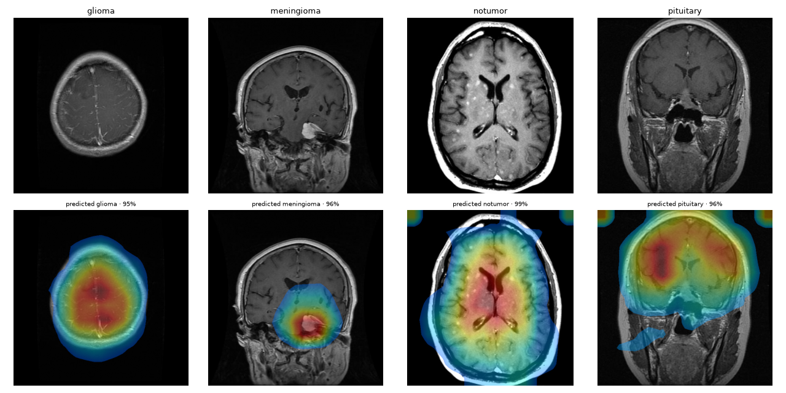

# NeuroLens

Brain tumor MRI analysis in one dashboard: **classify** the scan, **show where the model looked**, **outline the tumor**, and write a **plain-language report**.

> ⚠️ Research and portfolio project, **not a medical device**. Results are not a diagnosis. Trained only on public datasets.

## How it works

```
MRI upload → quality check → classifier → Grad-CAM → segmentation → features → report → dashboard
```

| Step | Model / tool | Output |
|---|---|---|
| Classify | EfficientNet-B0 + B3 ensemble (timm) | glioma · meningioma · pituitary · no tumor + confidence |
| Explain | Grad-CAM | heatmap of where the model looked |
| Segment | U-Net (segmentation_models_pytorch) | tumor mask + area |
| Report | Ollama or LLM API, template fallback | short summary from structured features |

## Engineering highlights

- **Leak-free data.** The public dataset has duplicate images, some in both train and test. They are found with MD5 + perceptual hashing and removed *before* training, so test scores are not inflated.
- **Honest evaluation.** Models are tuned on validation only. The test split is run once, at the end.
- **Transfer learning.** Pretrained backbones, strong augmentation, mixed precision, cosine learning rate, early stopping on macro-F1.
- **Ensemble + TTA.** Two different models (small B0, larger B3) make different mistakes. Averaging them, plus a flipped copy of each image, cuts val errors by about a third.
- **Explainability.** Every prediction comes with a Grad-CAM heatmap, so a wrong answer is easy to spot.

## Results

_Only measured numbers from real runs. `—` = not measured._

| Model | Metric | Target | Test result |
|---|---|---|---|
| Classifier | Accuracy | ≥ 95% | **99.0%** |
| Classifier | Macro-F1 | ≥ 95% | **99.0%** |
| Segmenter | Dice | ≥ 0.85 | — |

Final classifier: EfficientNet-B0 + B3 ensemble with TTA, measured once on 710 clean test images (7 errors), in full precision (fp32). [Test confusion matrix](ml/results/03_final/confusion_final_test.png).

**How the final model was picked** (validation split, 710 images, [`03_final_classifier.ipynb`](ml/notebooks/03_final_classifier.ipynb)):

| Option | Val accuracy | Val macro-F1 | Errors |
|---|---|---|---|
| **B0 + B3 ensemble + TTA** | **98.5%** | **98.4%** | **11** |
| B0 + TTA | 97.8% | 97.6% | 16 |
| B3 + TTA | 97.6% | 97.6% | 17 |
| EfficientNet-B0, 224 px | 97.6% | 97.3% | 17 |
| EfficientNet-B3, 384 px, strong augmentation | 97.5% | 97.4% | 18 |

Remaining errors are mostly glioma or pituitary scans predicted as meningioma. Training runs: [`02_baseline`](ml/results/02_baseline), [`02_baseline_rerun`](ml/results/02_baseline_rerun) (used in the ensemble), [`02_strong`](ml/results/02_strong).

## Explainability



The heatmap is the classifier weights × the last feature maps. For this model head that equals Grad-CAM (checked numerically in [`04_gradcam.ipynb`](ml/notebooks/04_gradcam.ipynb)), so it can be computed from an ONNX model's outputs, without PyTorch.

**What the heatmaps tell us (limitation):** for meningioma they sit on the tumor. For glioma, pituitary and no-tumor scans they often cover the whole brain, and some light up the image corners. This public dataset mixes several sources, roughly one per class, so the model also learns the look of each source, not only the tumor. The 99% is a score on this dataset, not a promise for real hospital scans. More: [per class](ml/results/04_gradcam/gradcam_per_class.png), [on the mistakes](ml/results/04_gradcam/gradcam_errors.png).

## Data

| Dataset | Used for |
|---|---|
| [Brain Tumor MRI Dataset](https://www.kaggle.com/datasets/masoudnickparvar/brain-tumor-mri-dataset) | classification, 4 classes |
| [LGG MRI Segmentation](https://www.kaggle.com/datasets/mateuszbuda/lgg-mri-segmentation) | segmentation masks |

Cleaning is done in [`01_data_prep.ipynb`](ml/notebooks/01_data_prep.ipynb):

| Data cleaning | Value |
|---|---|
| Images in the original dataset | 7,200 |
| Exact duplicate files | 187 |
| Unique scans after grouping near-copies | 4,755 |
| Scans found in both the original train and test folders | 520 |
| Groups dropped for conflicting labels | 25 |
| Images kept (train / val / test) | 4,730 (3,310 / 710 / 710) |

Many images are the same scan saved again with other contrast or sharpening. In the `notumor` class only 573 of 1,800 images are unique. Because the original test folder is mostly copies of training images, the clean scans are split again into 70 / 15 / 15, stratified by class.

## Tech stack

| Area | Tools |
|---|---|
| ML | PyTorch, timm, segmentation_models_pytorch, Albumentations |
| Serving | ONNX Runtime, FastAPI, Docker |
| Frontend | Next.js, Tailwind, shadcn/ui, Recharts |
| Data & reports | Supabase, Ollama / LLM API |
| CI / Deploy | GitHub Actions, Hugging Face Spaces, Vercel |

## Project layout

```
ml/notebooks/   training notebooks (run on Kaggle GPU)
ml/data/        splits.csv + data_report.json (no images in git)
ml/results/     metrics, confusion matrices, Grad-CAM figures
```

## License

[MIT](LICENSE). Datasets keep their own licenses.
