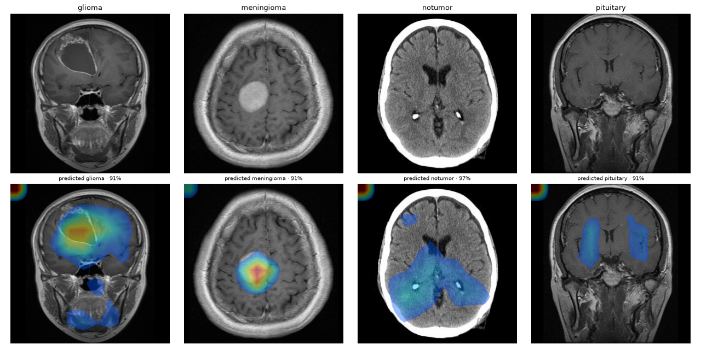

# NeuroLens

Brain tumor MRI analysis for doctors: **classify** the scan, **show where the model looked**, **segment the tumor in 3D** and measure it, and let a **doctor review and approve** the result before any report leaves the system.

> ⚠️ Research and portfolio project, **not a medical device**. Results are not a diagnosis. Trained only on public datasets.

## How it works

```
doctor login → new case (anonymous ID) → upload 3D MRI → quality check
→ classifier + Grad-CAM → 3D segmentation + volume → doctor review (approve / edit / reject) → approved PDF
```

| Step | Model / tool | Output |
|---|---|---|
| Classify | EfficientNet-B3 on brain-cropped scans (timm) | glioma · meningioma · pituitary · no tumor + confidence |
| Explain | Grad-CAM | heatmap of where the model looked |
| Segment | 3D U-Net / SegResNet (MONAI), BraTS | edema · tumor core · enhancing tumor masks + volume in cm³ |
| Review | 3D viewer (NiiVue) | doctor approves, edits or rejects; every action logged |
| Report | template, optional LLM draft (Ollama or LLM API) | doctor-approved PDF from structured features |

## Engineering highlights

- **Leak-free data.** The public dataset has duplicate images, some in both train and test. They are found with MD5 + perceptual hashing and removed *before* training, so test scores are not inflated.
- **Honest evaluation.** Models are compared on validation only. The test split is opened only for a model already picked on val.
- **Transfer learning.** Pretrained backbones, strong augmentation, mixed precision, cosine learning rate, early stopping on macro-F1.
- **Brain crop.** Every scan is cut to the head and padded to a square, so images from different sources have the same framing.
- **Simple over complex.** Ten options were compared (two backbones, with and without crop, test-time flips, ensembles). One B3 on cropped scans tied the best two-model ensemble, so the lighter option won: one network, one pass, about half the compute (no second model, no flipped copy).
- **Explainability.** Every prediction comes with a Grad-CAM heatmap, so a wrong answer is easy to spot.
- **ONNX export.** The final model and its heatmap run in ONNX Runtime with numpy-only preprocessing, so serving needs no PyTorch. Checked on all 710 val images: same predictions, same heatmaps.

## Results

_Only measured numbers from real runs. `—` = not measured._

| Model | Metric | Target | Test result |
|---|---|---|---|
| Classifier | Accuracy | ≥ 95% | **99.4%** |
| Classifier | Macro-F1 | ≥ 95% | **99.3%** |
| 3D segmenter | Dice, whole tumor | ≥ 0.85 | — |
| 3D segmenter | Dice, tumor core | ≥ 0.75 | — |
| 3D segmenter | Dice, enhancing tumor | ≥ 0.70 | — |

Final classifier: EfficientNet-B3 (384 px) on brain-cropped scans, 710 clean test images, 4 errors, full precision (fp32). [Test confusion matrix](ml/results/03_final/confusion_final_test.png) · [Model card](ml/MODEL_CARD.md) (intended use, per-class scores, limitations).

**ONNX** ([report](ml/results/05_onnx/onnx_report.json), [`05_onnx_export.ipynb`](ml/notebooks/05_onnx_export.ipynb)): 43.7 MB file, 710 / 710 val predictions identical to PyTorch (max logit difference 0.00002), about 53 ms per scan on a laptop CPU (Apple M3) vs 345 ms in PyTorch.

The test split was opened twice: first for the earlier B0 + B3 ensemble (99.0% accuracy, 7 errors, [results](ml/results/03_final_ensemble)), then for this model, which was picked on val *before* its test run.

**How the final model was picked** (validation split, 710 images, [`03_final_classifier.ipynb`](ml/notebooks/03_final_classifier.ipynb)):

| Option | Val accuracy | Val macro-F1 | Errors |
|---|---|---|---|
| **B3 + brain crop** | **98.5%** | **98.5%** | **11** |
| B0 + B3 ensemble + TTA | 98.5% | 98.4% | 11 |
| B3 + brain crop + TTA | 98.0% | 98.0% | 14 |
| B0 + B3 crop ensemble + TTA | 98.0% | 97.9% | 14 |
| B0 + TTA | 97.8% | 97.6% | 16 |
| B3 + TTA | 97.6% | 97.6% | 17 |
| B0 + brain crop | 97.6% | 97.6% | 17 |
| B0 + brain crop + TTA | 97.3% | 97.1% | 19 |
| EfficientNet-B0, 224 px | 97.6% | 97.3% | 17 |
| EfficientNet-B3, 384 px, strong augmentation | 97.5% | 97.4% | 18 |

TTA = the prediction is averaged with a left-right flipped copy. Training runs: [`02_crop`](ml/results/02_crop) (final), [`02_baseline_rerun`](ml/results/02_baseline_rerun), [`02_strong`](ml/results/02_strong), [`02_baseline`](ml/results/02_baseline).

## Explainability



The heatmap is the classifier weights × the last feature maps. For this model head that equals Grad-CAM (checked numerically in [`04_gradcam.ipynb`](ml/notebooks/04_gradcam.ipynb)), so it can be computed from an ONNX model's outputs, without PyTorch.

**What the heatmaps tell us (limitation):**
- **Meningioma and many glioma maps sit on the tumor.** Pituitary maps often light up the ventricles instead of the gland, and no-tumor maps are weak and spread out.
- **Almost every map has a small hot spot in the top-left corner,** even on black padding. It looks like a network edge effect, not the tumor.
- **The brain crop did not remove the shortcut.** It was added because this public dataset mixes several sources, roughly one per class, so a model can learn the look of each source. It kept the score, but the heat outside the head did not drop. Measured against a flat heatmap (= 1.0): the two-model ensemble went from 0.51 without crop to 0.50 with it, and the final single model scores 0.64, since one model's map is not smoothed by averaging.
- **The 99% is a score on this dataset, not a promise for real hospital scans.**

More: [per class](ml/results/04_gradcam_final/gradcam_per_class_final.png), [on the mistakes](ml/results/04_gradcam_final/gradcam_errors_final.png), [earlier ensemble without crop](ml/results/04_gradcam), [ensemble with crop](ml/results/04_gradcam_crop).

## Data

| Dataset | Used for |
|---|---|
| [Brain Tumor MRI Dataset](https://www.kaggle.com/datasets/masoudnickparvar/brain-tumor-mri-dataset) | classification, 4 classes |
| [BraTS 2021, Task 1](https://www.kaggle.com/datasets/dschettler8845/brats-2021-task1) | 3D segmentation: 4 MRI types (T1, T1ce, T2, FLAIR) + expert masks, split by patient |

BraTS 2021 is shared under [CC BY 4.0](https://doi.org/10.7937/jc8x-9874). Please cite Baid et al. 2021 ([arXiv:2107.02314](https://arxiv.org/abs/2107.02314)), Menze et al. 2015 and Bakas et al. 2017. It is checked in [`06_brats_data.ipynb`](ml/notebooks/06_brats_data.ipynb) ([report](ml/data/brats_report.json)):

| BraTS check | Value |
|---|---|
| Patients with all 4 MRI types + mask | 1,251 |
| Volume size and voxel | 240 × 240 × 155, 1 mm (all cases) |
| Mask labels | 0 background, 1 necrotic core, 2 edema, 4 enhancing (no others) |
| Whole tumor volume, median (range) | 89 cm³ (3 – 362) |
| Cases with no enhancing part | 33 |
| Split by patient (train / val / test) | 875 / 188 / 188, stratified by tumor size ([`brats_splits.csv`](ml/data/brats_splits.csv)) |
| Masks line up with the scans | yes: 100% of tumor voxels inside the brain in the [checked patients](ml/results/06_brats/brats_slices.png), also after the [training transforms](ml/results/06_brats/brats_patch.png) |

Cleaning is done in [`01_data_prep.ipynb`](ml/notebooks/01_data_prep.ipynb):

| Data cleaning | Value |
|---|---|
| Images in the original dataset | 7,200 |
| Exact duplicate files | 187 |
| Unique scans after grouping near-copies | 4,755 |
| Scans found in both the original train and test folders | 520 |
| Groups dropped for conflicting labels | 25 |
| Images kept (train / val / test) | 4,730 (3,310 / 710 / 710) |

Many images are the same scan saved again with other contrast or sharpening. In the `notumor` class only 573 of 1,800 images are unique. Because the original test folder is mostly copies of training images, the clean scans are split again into 70 / 15 / 15, stratified by class.

## Tech stack

| Area | Tools |
|---|---|
| ML | PyTorch, timm, MONAI, Albumentations |
| Serving | ONNX Runtime, FastAPI, Docker |
| Frontend | Next.js, Tailwind, shadcn/ui, Recharts, NiiVue |
| Data & reports | Supabase, Ollama / LLM API |
| CI / Deploy | GitHub Actions, Hugging Face Spaces, Vercel |

## Project layout

```
ml/neurolens_ml/  Python package: data, models, train / evaluate / export CLIs
ml/configs/     one YAML file per training run
ml/notebooks/   training notebooks (run on Kaggle GPU)
ml/data/        data splits and data reports (no images in git)
ml/results/     metrics, confusion matrices, Grad-CAM figures
ml/MODEL_CARD.md  what the classifier is for, how it was tested, its limits
```

## Run it

```bash
pip install -e "ml[export,dev,seg]"
pytest ml                       # leak-free splits, crop, model outputs, a tiny training run, BraTS loading and 3D transforms
python -m neurolens_ml.train    --config ml/configs/cls_b3.yaml --data <dataset folder>
python -m neurolens_ml.evaluate --config ml/configs/cls_b3.yaml --checkpoint outputs/classifier_strong_crop.pt
python -m neurolens_ml.export   --config ml/configs/cls_b3.yaml --checkpoint outputs/classifier_strong_crop.pt
python -m neurolens_ml.prep_brats --data <BraTS folder>   # check the 3D data: cases, labels, tumor volumes
python -m neurolens_ml.split_brats                        # patient split from brats_cases.csv, no scans needed
python -m neurolens_ml.plot_brats  --data <BraTS folder>   # slices with the expert mask on top
```

`evaluate` uses val by default; `--split test` is for the final model only. On Kaggle, [`02_classifier.ipynb`](ml/notebooks/02_classifier.ipynb) clones the repo and runs the same `train` command on a GPU.

## License

[MIT](LICENSE). Datasets keep their own licenses.
