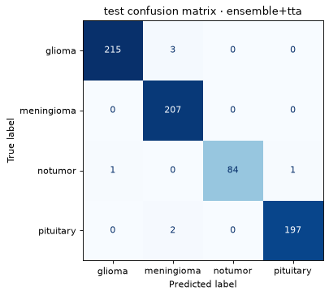

# Model card: NeuroLens brain tumor classifier

> ⚠️ Research and portfolio model, **not a medical device**. Its output is not a diagnosis.

## Summary

| | |
|---|---|
| Task | Classify one 2D brain MRI slice into 4 classes: glioma, meningioma, pituitary tumor, no tumor |
| Model | EfficientNet-B3 (timm, ImageNet-pretrained), fine-tuned at 384 × 384 px |
| Input | One RGB image of an MRI slice. Cropped to the head and padded to a square, then resized and normalized (ImageNet mean/std) |
| Output | 4 class probabilities + one Grad-CAM heatmap per class (12 × 12, upsampled to the image) |
| Serving file | `classifier.onnx`, 43.7 MB, ONNX opset 18, dynamic batch ([export](notebooks/05_onnx_export.ipynb)) |
| Test result | **99.4% accuracy, 99.3% macro-F1** (710 images, 4 errors) |

## Intended use

- **For:** showing how a leak-free, explainable image classifier is built, evaluated and served. Demos, learning, portfolio.
- **Not for:** clinical decisions, screening or triage, or any use on real patients. It was never validated on hospital data or checked by a radiologist.
- **Out of scope:** 3D volumes, other tumor types, other organs, CT or other scan types. These still get one of the 4 labels, so their output means nothing.

## Data

[Brain Tumor MRI Dataset](https://www.kaggle.com/datasets/masoudnickparvar/brain-tumor-mri-dataset) (public, Kaggle). It mixes several older public sets, roughly one source per class.

The 7,200 images were cleaned in [`01_data_prep.ipynb`](notebooks/01_data_prep.ipynb):
- Exact duplicates were found with MD5 and near-copies with perceptual hashing.
- Copies were grouped, and groups with conflicting labels were dropped.
- One image was kept per group, then everything was split again 70 / 15 / 15, stratified by class.

The original test folder was mostly copies of training images, so it was not used.

| Class | Train | Val | Test |
|---|---|---|---|
| glioma | 1,017 | 218 | 218 |
| meningioma | 965 | 207 | 207 |
| no tumor | 401 | 86 | 86 |
| pituitary | 927 | 199 | 199 |
| **Total** | **3,310** | **710** | **710** |

No tumor is the smallest class (573 unique scans of 1,800 files), so the loss uses class weights.

## Training

[`02_classifier.ipynb`](notebooks/02_classifier.ipynb), preset `strong`, on a Kaggle T4 GPU.

- **Optimizer:** AdamW (lr 3e-4, weight decay 1e-4), batch 24.
- **Schedule:** 1 warmup epoch, then cosine.
- **Loss:** class-weighted cross-entropy, label smoothing 0.1.
- **Precision:** mixed precision on the GPU; the loss is computed in fp32.
- **Augmentation:** flip, affine (scale, shift, rotate ±20°), brightness/contrast, gamma, Gaussian blur, noise, coarse dropout.
- **Stopping:** early stopping on val macro-F1 (patience 7). The best epoch was 15 of 22.
- **Reproducibility:** seed 42.

## Evaluation

The model was picked on **val only**, out of 10 options (B0 vs B3, with and without crop, flip TTA, ensembles; see the [README](../README.md#results)). Then the test split was run once for it, in fp32.

| Class | Precision | Recall | F1 | Test images |
|---|---|---|---|---|
| glioma | 99.5% | 100.0% | 99.8% | 218 |
| meningioma | 99.0% | 100.0% | 99.5% | 207 |
| no tumor | 100.0% | 97.7% | 98.8% | 86 |
| pituitary | 99.5% | 99.0% | 99.2% | 199 |
| **Overall** | | **99.4% accuracy** | **99.3% macro-F1** | **710** |

The 4 test errors:
- 2 pituitary scans → meningioma;
- 1 no-tumor scan → glioma;
- 1 no-tumor scan → pituitary.

On val the model makes 11 errors of 710 (98.5%).

**About the test split:** it was opened twice in this project. The first time was for an earlier B0 + B3 ensemble (99.0%, 7 errors). The second was for this model, which was picked on val before its test run. Both numbers are reported.

**ONNX check** ([report](results/05_onnx/onnx_report.json)):
- All 710 val images give the same prediction in ONNX and PyTorch.
- The largest logit difference is 0.00002, and the heatmap correlation is 1.0.
- Speed for one scan on a laptop CPU (Apple M3): about 53 ms in ONNX Runtime and 345 ms in PyTorch, plus 2.5 ms of preprocessing.

## Explainability

Each heatmap is the classifier weights × the last feature maps. For this model head that is equal to Grad-CAM, and this was checked numerically in [`04_gradcam.ipynb`](notebooks/04_gradcam.ipynb). Examples: [per class](results/04_gradcam_final/gradcam_per_class_final.png), [on mistakes](results/04_gradcam_final/gradcam_errors_final.png).

## Limitations and risks

- **Dataset shortcut.** Each class comes mostly from one source, so the model can learn how a source looks (framing, contrast, sharpness) and not only the tumor. Cropping to the head kept the score but did not reduce heat outside the head. The 99% is a score on this dataset only and would very likely drop on scans from a new hospital or scanner.
- **Heatmaps are only partly on target.**
  - Meningioma and many glioma maps sit on the tumor.
  - Pituitary maps often light up the ventricles rather than the gland.
  - No-tumor maps are weak and spread out.
  - Almost every map has a small hot spot in the top-left corner (a network edge effect), which can be ignored.
- **One public dataset.** It has no patient IDs, so near-copies are removed by image hashing only. Two different slices of the same patient can still sit in different splits.
- **No "unknown" answer.** The model always picks one of the 4 classes. Images that are not brain MRI need a separate check before this model.
- **Confidence is not calibrated.** Training used label smoothing, so probabilities are softer than real chances; read them as a ranking.

## Files

| File | What it is |
|---|---|
| `models/classifier_strong_crop.pt` | PyTorch weights (not in git) |
| `models/classifier.onnx` | serving model (not in git) |
| [`results/02_crop/`](results/02_crop) | training curves, val confusion matrix, val errors |
| [`results/03_final/`](results/03_final) | final val + test metrics, test confusion matrix |
| [`results/04_gradcam_final/`](results/04_gradcam_final) | heatmaps of the final model |
| [`results/05_onnx/`](results/05_onnx) | ONNX check and speed |
